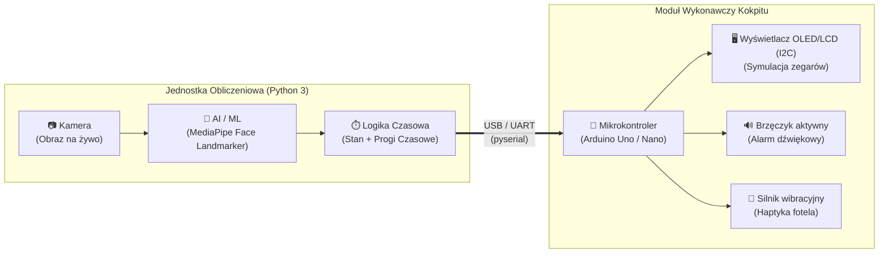

# 👁️ MiraiSight DMS-AI

**Driver Monitoring System Prototype for Next-Gen ADAS**  
*Od analizy obrazu AI w czasie rzeczywistym do wielozmysłowej reakcji sprzętowej*

---

[**O projekcie**](#-o-projekcie) •
[**Kluczowe funkcjonalności**](#-kluczowe-funkcjonalności) •
[**Architektura systemu**](#️-architektura-systemu) •

---

## 📖 O projekcie

**MiraiSight DMS-AI** to zintegrowany prototyp systemu monitorowania stanu kierowcy (*Driver Monitoring System – DMS*), będący częścią zaawansowanych systemów wspomagania kierowcy (**ADAS** – *Advanced Driver Assistance Systems*). 

Tradycyjne systemy ostrzegania często ograniczają się do wyświetlenia płaskiego komunikatu na ekranie nawigacji, który łatwo przeoczyć w stanie silnego zmęczenia. **MiraiSight DMS-AI** rozwiązuje ten problem, łącząc komputerową analizę wizyjną w czasie rzeczywistym z fizycznym modułem wykonawczym, który oddziałuje na **trzy zmysły kierowcy jednocześnie**:
1. **Wzrok** – natychmiastowy komunikat ostrzegawczy na dedykowanym wyświetlaczu (symulacja cyfrowych zegarów kokpitu).
2. **Słuch** – przenikliwy sygnał akustyczny generowany przez aktywny brzęczyk.
3. **Dotyk (Haptyka)** – fizyczne wibracje silnika haptycznego symulujące drżenie fotela kierowcy lub wolantu.

### Kontekst rynkowy i regulacyjny
Zgodnie z rozporządzeniem Komisji Europejskiej (**General Safety Regulation – GSR**), od **7 lipca 2024 r.** systemy monitorowania senności i uwagi kierowcy są obowiązkowym wyposażeniem wszystkich nowo homologowanych i rejestrowanych pojazdów w Unii Europejskiej. Repozytorium `miraisight-dms` dostarcza kompletną platformę demonstracyjną łączącą warstwę oprogramowania AI z dedykowanym modułem sprzętowym.

---

## ✨ Kluczowe funkcjonalności

* **Analiza wizyjna w czasie rzeczywistym:** Płynne przechwytywanie strumienia wideo i precyzyjna detekcja punktów charakterystycznych twarzy przy użyciu potoku **OpenCV + MediaPipe**.
* **Inteligentna logika czasowa:** Algorytm analizuje czas trwania zamknięcia powiek, odróżniając naturalne, krótkie mrugnięcia od faktycznego mikro-snu za pomocą konfigurowalnych progów czasowych.
* **Bezpieczna obsługa stanów nieoznaczonych:** Utrata widoczności twarzy w kadrze (np. zasłonięcie kamery, odwrócenie głowy, wyjście poza kadr) nigdy nie jest klasyfikowana jako stan „bezpieczny” – system natychmiast przechodzi w dedykowany stan.
* **Niskoopóźnieniowa komunikacja:** Szybka wymiana ramek stanu pomiędzy jednostką obliczeniową a mikrokontrolerem za pośrednictwem interfejsu szeregowego (`UART / USB`).
* **Synchroniczna reakcja multimodalna:** Pojedyncze zdarzenie przekroczenia progu senności wyzwala w ułamku sekundy zsynchronizowaną reakcję wszystkich trzech wyjść sprzętowych (wyświetlacz I2C, brzęczyk, silnik wibracyjny) oraz automatycznie przywraca stan czuwania po odzyskaniu koncentracji przez kierowcę.
* **Prywatność w fazie projektowania:** Całość przetwarzania obrazu odbywa się w 100% lokalnie w pamięci operacyjnej urządzenia - system domyślnie nie zapisuje ani nie wysyła nagrań wideo do chmury.

---

## 🏗️ Architektura systemu

### Architektura MVP (Host PC + Moduł Wykonawczy Hardware)
W konfiguracji zawartej w tym repozytorium ciężar wnioskowania AI/ML oraz logiki czasowej spoczywa na jednostce centralnej (pełniącej funkcję komputera pokładowego pojazdu). Komunikuje się ona przez port szeregowy z mikrokontrolerem zarządzającym peryferiami wykonawczymi.

---

  MiraiSight DMS-AI • Advanced Driver Assistance Systems (ADAS) Prototype

